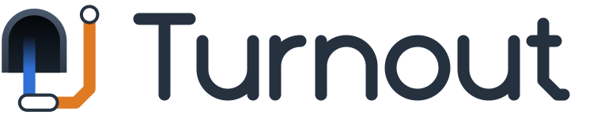

<p>
  <picture>
    <source media="(prefers-color-scheme: dark)" srcset="assets/logo-dark.svg">
    
  </picture>
</p>

Turnout is a VPN client for macOS that connects to WireGuard servers the way `wg-quick` does, in a native app: your `PreUp`/`PostUp` hooks run, your routes stay yours, and you choose which network interface the tunnel leaves through. It lives in the menu bar, follows the network as it changes, can connect by schedule or Wi-Fi network, and cleans up after itself. It is a paid app: US$19 once for three Macs, after a 7-day trial ([price and license](#price)).

This repository holds:

- the website, <https://turnout.ctsite.cc/>
- the installer downloads, under [Releases](https://github.com/tasict/Turnout/releases)
- the [issue tracker](https://github.com/tasict/Turnout/issues)

## Installing

<!-- download:soon -->
**Coming soon.** The first public release is being prepared; until then there is nothing to download. Watch this repository, or its [Releases](https://github.com/tasict/Turnout/releases) page, for the first one.
<!-- /download:soon -->

Turnout needs macOS 15 or later, on Apple silicon or Intel.

1. Download `Turnout-<version>.pkg` from the [latest release](https://github.com/tasict/Turnout/releases/latest).
2. Open it and follow the steps. Turnout is installed in `/Applications` and opens when the installer finishes.
3. In Turnout's window, install the background service, then allow it when macOS asks, in System Settings › General › Login Items & Extensions.

The installer is signed with a Developer ID but not yet notarized by Apple, so macOS may refuse to open it. If it does, go to System Settings › Privacy & Security, choose Open Anyway, and open the installer again.

What the background service does to your Mac, and how to check it, is on [What Turnout does to your Mac](https://turnout.ctsite.cc/how-it-works.html).

## What Turnout sends

Turnout has no account, no advertising and no crash reporting. The installed app checks GitHub for a new version when you open its menu or a window (at most once an hour) and when you choose Check for Updates…. With each check it also sends one anonymous event to Google Analytics, so the developer can tell how many installations are in use and on which versions: a random installation ID that Turnout makes up on first use and keeps in its preferences (not derived from the hardware), the Turnout version and build, the macOS version, the processor architecture and the system language. Nothing about your tunnels, servers, keys or networks is ever sent. That request goes to google-analytics.com and is covered by the [Google Privacy Policy](https://policies.google.com/privacy).

Switching off **Check for updates automatically** in General (Turnout › Settings…) stops both the check and the report.

No license check runs during the trial. Once you have bought a license, the app activates and checks it with Polar, which sells Turnout: when you activate a Mac, about once a week when you open its menu or window, and when you remove a Mac. It sends the license key, the name you give the Mac, its model identifier, the macOS and Turnout versions and a one-way hash of its hardware identifier, never anything about your tunnels. The key and the list of your Macs are kept in your own iCloud account, so your other Macs find the license. If Polar cannot be reached, a licensed Mac keeps connecting.

The details are in the [privacy policy](https://turnout.ctsite.cc/privacy.html).

## Reporting a problem

[Open an issue](https://github.com/tasict/Turnout/issues/new?template=bug_report.md). It helps to include:

- your macOS version, and Turnout's version from Turnout › About Turnout
- what you did, what you expected, and what happened instead
- the lines of the background service's log from around that time, in `/Library/Logs/cc.ctsite.turnout.daemon.log` (Help › Show Logs in Finder shows it)
- the app's own log:

  ```sh
  /usr/bin/log show --predicate 'subsystem == "cc.ctsite.turnout"' --last 1h
  ```

Issues are public: leave out private keys, preshared keys, server addresses and whole config files.

## Price

Turnout is paid: US$19 once for three Macs (yours, your household's, or within one organization), with every update to Turnout 1. Try it first: 7 days on each Mac, and 7 more if you ask, with no account, no card and no license check. After the trial only connecting needs a license; tunnels that are connected stay connected, and everything else keeps working.

[Polar](https://polar.sh/) sells it and handles the payment, tax and receipt; your key appears on Polar's page as soon as you have paid, and stays on your Polar purchases page. Not for you? A refund within 14 days, no questions. The details are in the [license terms](https://turnout.ctsite.cc/license.html).

## The website

Plain static HTML and one stylesheet, in four languages (English, 繁體中文, 日本語, Español), served by GitHub Pages from this repository's `main` branch as it stands, at <https://turnout.ctsite.cc/>; there is no build step. The screenshots in `assets/` are taken from the app itself.

- [Turnout](https://turnout.ctsite.cc/)
- [What Turnout does to your Mac](https://turnout.ctsite.cc/how-it-works.html)
- [Privacy policy](https://turnout.ctsite.cc/privacy.html)
- [License terms](https://turnout.ctsite.cc/license.html)

© 2026 tasict
